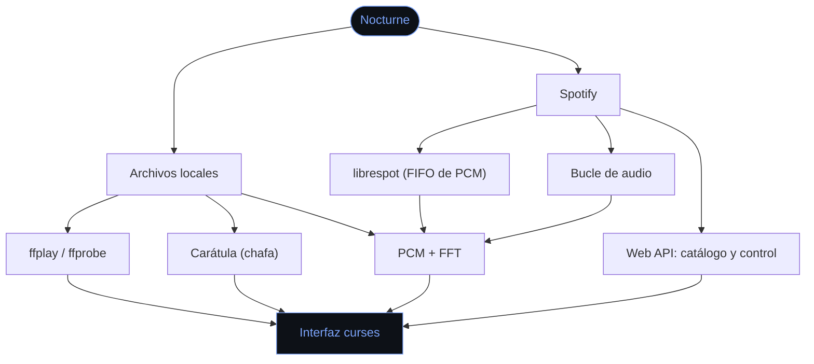

<div align="center">

# ♪ Nocturne

**Vive en la terminal. Empieza por la música.**

Un reproductor de música para la terminal: explorador de carpetas, espectro en tiempo real,<br>
carátulas a todo color y tu Spotify, sin salir de la consola.

<br>


[Funcionalidades](#-funcionalidades) ·
[Instalación](#-instalación) ·
[Uso](#-uso) ·
[Teclas](#-teclas) ·
[Spotify](#-spotify) ·
[Por dentro](#-por-dentro) ·
[Roadmap](#-roadmap)

<br>


</div>

---

## ✦ ¿Qué es Nocturne?

Nocturne nace de una idea sencilla: **tener todo lo que uso, sin salir de la terminal**. El primer paso es un reproductor de música, y la idea es que crezca con más herramientas pensadas para vivir en la consola.

Está hecho para un público concreto: quien disfruta de la estética de la terminal, trabaja a golpe de teclado y prefiere una interfaz que no le saque de ahí.

- Se maneja entera con el teclado.
- No necesita instalar nada con `pip`: la FFT del espectro está escrita en Python puro.
- Reproduce tus archivos locales y también tu Spotify.

<details>
<summary><b>Versión en texto de la interfaz</b></summary>
<br>

```text
 ♪ NOCTURNE  ~/Music                                                                   ▶ sonando
╭─ BIBLIOTECA ──────── 2 elem. ─╮ ╭─ REPRODUCIENDO ──────────────────────────────────────── 1/1 ─╮
│ ↑ ..                          │ │ ▏▄▄▂▗▄▄▄▃▄▄▄▄▄▄▄▄▂                                           │
│ ▶ HAVEN. - I Run.mp3     2:09 │ │ ▕▏▕▝▋▏▏ ▔ ▋▗▊▏▕▏▕▏  I Run                                    │
│                               │ │ ▕▏▕▖▋▕▔▏▗ ▋▏▊▏▁▔▕▄  Haven., Kaitlin Aragon                   │
│                               │ │ ▎▏▕▍▋▎▗▌▍▁▝▖▊▏▊▏▕▕  I Run · 2025                             │
│                               │ │ ▕▅▅▁▝▅▅▅▘▅▄▅▅▅▅▅▅▌  Electro                                  │
│                               │ │ ▕▏▁▝▘▔▁▝▔▏▝▁▖▏▕▋▆▎                                           │
│                               │ │ ▗▝▆▆▎▗▖▏▏▏▕▏▏▊▝▃▘▊  MP3 · 320 kbps · 44.1 kHz · estéreo      │
│                               │ │ ▏▌▂▘▂▕▁▕▔▏▕▆▏▗▄▞▘▊                                           │
│                               │ │ ▖▕▁▝▄▝▝▁▂▅▃▅▖▃▄▏▃▏                                           │
│                               │ ╰──────────────────────────────────────────────────────────────╯
│                               │ ╭─ ESPECTRO ──────────────────────────────────────── espectro ─╮
│                               │ │                                           ▔                  │
│                               │ │                         ▔     ▔     ▁   ▃ ▂   ▔ ▆            │
│                               │ │                     ▔ ▔ ▆ ▔ ▔ █ ▇ ▁ █ ▔ █ █ ▔ █ █ ▅ ▔        │
│                               │ │                   ▔   ▂ █ █ ▁ █ █ █ █ █ █ █ █ █ █ █ █ ▔ ▔ ▔  │
│                               │ │                   ▃ ▃ █ █ █ █ █ █ █ █ █ █ █ █ █ █ █ █ ▇ █ █  │
│                               │ │           ▁ ▔ ▔ ▔ █ █ █ █ █ █ █ █ █ █ █ █ █ █ █ █ █ █ █ █ █  │
│                               │ │                 ▇ ▅ ▅ ▃ █ █ ▃ █ █ ▁ █ █ █ █ █ █ █ █ ▁ ▄ ▃ ▃  │
│                               │ │                         ▇     ▅ ▇   ▆   ▅ ▆ ▇ ▅ ▄ ▇          │
╰───────────────────────────────╯ ╰──────────────────────────────────────────────────────────────╯
  0:03 ━━●───────────────────────────────────────────────────────────────────────────────── 2:09
                                                                               ♪ ▱▱▱▱▱▱▱▱▱▱  70%
  espacio sonar · ↑↓ mover · → abrir · ← atrás · ,. saltar · n/N pista · v vista · / buscar · ?…
```

El bloque de la izquierda del panel *REPRODUCIENDO* es la carátula del disco a todo color; aquí se ve en blanco y negro porque es texto plano.

</details>

---

## ✨ Funcionalidades

| | Funcionalidad | Qué hace |
|:-:|---|---|
| 📂 | **Biblioteca local** | Explorador de carpetas con etiquetas leídas en segundo plano, búsqueda, orden natural y cientos de canciones sin atascos |
| 📊 | **Espectro en tiempo real** | FFT sobre la posición exacta de reproducción, dibujada con caracteres y sincronizada con el audio |
| 🌊 | **Tres visualizadores** | Barras, onda (osciloscopio en braille) o los dos a la vez |
| 🖼️ | **Carátulas a todo color** | Extrae la imagen incrustada (o un `cover.jpg`) y la dibuja en la terminal con `chafa` |
| 🎧 | **Spotify integrado** | Navega tus playlists, álbumes y canciones guardadas, busca en el catálogo y reproduce sin salir de la terminal |
| ⌨️ | **Todo con el teclado** | Atajos estilo vim (`hjkl`), saltos por porcentaje, aleatorio, repetición y cola |

### 🌊 Los tres visualizadores

- **espectro** — barras por bandas logarítmicas (40 Hz – 10 kHz) con reflejo y marcas de pico que caen despacio.
- **onda** — osciloscopio dibujado con puntos braille, a cuádruple resolución vertical.
- **dual** — barras arriba, onda abajo.

Cambia entre ellos con `v` / `V`, o arranca con uno concreto: `nocturne --viz wave`.

---

## 📦 Instalación

| Herramienta | Para qué | Obligatorio |
|---|---|:-:|
| `python3` (3.10+) | el programa | ✅ |
| `ffplay`, `ffprobe`, `ffmpeg` | reproducir, leer etiquetas y decodificar | ✅ |
| `chafa` | dibujar la carátula | opcional |
| `librespot` | reproducir Spotify dentro de Nocturne | opcional |

```sh
brew install ffmpeg chafa
```

> [!NOTE]
> Nocturne está desarrollado y probado en **macOS**. Está escrito en Python y usa herramientas que también existen en Linux, pero no lo he probado allí. Una de las opciones de Spotify (el bucle de audio con BlackHole) es específica de macOS.

Para clonarlo y tenerlo disponible desde cualquier sitio:

```sh
git clone https://github.com/Alexxalataaa/nocturne.git
cd nocturne
ln -s "$PWD/bin/nocturne" /opt/homebrew/bin/nocturne
```

---

## 🚀 Uso

```sh
nocturne              # la carpeta actual
nocturne ~/Music      # una carpeta concreta
nocturne cancion.mp3  # empieza sonando ese archivo
```

Si no lo has enlazado a tu `PATH`, usa `./bin/nocturne` desde la carpeta del proyecto.

<details>
<summary><b>Todas las opciones</b></summary>
<br>

| Opción | Qué hace |
|---|---|
| `-v`, `--volume 0-100` | volumen inicial (80 por defecto) |
| `--viz bars\|wave\|dual` | visualizador con el que arranca |
| `--no-art` | no dibujar carátulas |
| `--symbols ...` | juego de símbolos de chafa (`vhalf+block+space` por defecto) |
| `--fps N` | refrescos por segundo (30 por defecto) |
| `--sync SEG` | desplaza el espectro respecto al audio si lo notas adelantado |
| `--spotify` | arrancar directamente en el árbol de Spotify |
| `--spotify-login` | autorizar Nocturne en tu cuenta (ver [Spotify](#-spotify)) |
| `--spotify-device-login` | autorizar el altavoz librespot (una sola vez) |
| `--no-spotify` | ignorar Spotify aunque esté configurado |
| `--spotify-audio ...` | `auto`, `pipe`, `loopback` o `none` |
| `--spotify-lag SEG` | retraso del espectro respecto a lo que ya suena |

</details>

---

## 🎹 Teclas

<table>
<tr>
<td valign="top" width="50%">

**Reproducción**

| Tecla | Acción |
|---|---|
| `espacio`, `p` | reproducir o pausar |
| `Intro`, `→` | abrir carpeta o hacer sonar |
| `n` / `N` | pista siguiente / anterior |
| `.` / `,` | saltar ±5 s |
| `>` / `<` | saltar ±30 s |
| `0`–`9` | saltar al 0 %–90 % |
| `s` | aleatorio |
| `r` | repetir: no → carpeta → una |
| `a` | encadenar pistas al terminar |

</td>
<td valign="top" width="50%">

**Navegación**

| Tecla | Acción |
|---|---|
| `↑` `↓` o `k` `j` | mover la selección |
| `→` o `l` | entrar en la carpeta |
| `←` o `h` | volver atrás |
| `g` / `G` | principio / final |
| `RePág` / `AvPág` | página arriba / abajo |
| `/` | buscar (`Esc` limpia) |
| `u` | recargar la carpeta |
| `o` | mostrar archivos que no son audio |

</td>
</tr>
<tr>
<td valign="top">

**Spotify**

| Tecla | Acción |
|---|---|
| `S` | saltar entre tus archivos y Spotify |
| `/` | en Spotify, `Intro` busca en el catálogo |
| `d` | ver dispositivos a la escucha |

</td>
<td valign="top">

**Sonido y vista**

| Tecla | Acción |
|---|---|
| `+` / `-` | volumen ±5 |
| `m` | silenciar |
| `v` / `V` | cambiar de visualizador |
| `c` | mostrar u ocultar la carátula |
| `?` | ayuda |
| `q` | salir |

</td>
</tr>
</table>

---

## 🎧 Spotify

Nocturne puede navegar tus playlists y reproducirlas sin salir de la terminal.

> [!IMPORTANT]
> Para controlar la reproducción hace falta **Spotify Premium**: la API de Connect no lo permite con cuentas gratuitas. Navegar y ver metadatos sí funciona sin Premium.

<div align="center">

</div>

### Conectarlo (una sola vez)

1. Entra en el [panel de desarrolladores de Spotify](https://developer.spotify.com/dashboard) y crea una app (el nombre da igual).
2. Añade esta Redirect URI, exacta: `http://127.0.0.1:8898/callback`. Tiene que ser la IP: desde 2025 Spotify ya no acepta `localhost`.
3. Copia el *client id* y ejecuta:

```sh
nocturne --spotify-login --spotify-client-id TU_CLIENT_ID
```

Se abre el navegador, autorizas y listo. Para borrar la sesión: `nocturne --spotify-logout`.

> [!TIP]
> **Tus credenciales no viven en el proyecto.** El refresh token se guarda en `~/.config/nocturne/spotify.json` con permisos `600` y se renueva solo. No hace falta *client secret* porque el flujo es Authorization Code + PKCE.

Dentro de Nocturne, `S` salta entre tus carpetas y el árbol de Spotify: playlists, canciones guardadas, álbumes, artistas seguidos y búsqueda. Cada árbol recuerda dónde lo dejaste. La cola, el aleatorio y la repetición las sigue llevando Nocturne: las pistas se mandan de una en una para que Spotify no encadene por su cuenta.

### De dónde sale el sonido

Nocturne **controla** la reproducción, pero el audio lo pone un dispositivo de Spotify Connect. Hay dos formas de montarlo, y de ellas depende si hay espectro:

| | Opción | Espectro | Notas |
|:-:|---|:-:|---|
| **a** | `librespot` | ✅ exacto | Todo en la terminal. Zona gris con los términos de Spotify (ver abajo) |
| **b** | App oficial + bucle de audio | ✅ | Sin zona gris. Requiere BlackHole o similar |
| | Ninguna | ❌ | Navegas y controlas igual, pero el espectro se queda quieto |

<details>
<summary><b>a) librespot: todo en la terminal, con espectro exacto</b></summary>
<br>

`librespot` es un cliente de Connect de ingeniería inversa que sabe escribir PCM crudo a un FIFO. Nocturne lo lee, lo manda a la salida de audio con ffmpeg y de camino se queda una copia para la FFT, así que el dibujo corresponde exactamente a lo que suena.

```sh
brew install librespot
nocturne --spotify-device-login    # una sola vez
```

A partir de ahí no hay que hacer nada más: Nocturne arranca librespot solo al reproducir la primera canción y lo mata al salir. El altavoz se llama **Nocturne** y tiene prioridad sobre cualquier otro dispositivo tuyo.

Ese login es aparte del de Nocturne porque librespot usa su propio client id de Spotify; las credenciales quedan en `~/.cache/nocturne/librespot`.

> [!WARNING]
> librespot incumple los términos de servicio de Spotify. En la práctica lo usan miles de instalaciones (moOde, Volumio, spotifyd) y los baneos por esto son rarísimos, pero la cuenta es tuya y la decisión también.

</details>

<details>
<summary><b>b) La app oficial + un bucle de audio: sin zona gris</b></summary>
<br>

Deja sonando la app de Spotify y captura la salida del sistema con un dispositivo de bucle ([BlackHole](https://existential.audio/blackhole) y un dispositivo de salida múltiple, por ejemplo). Nocturne lo detecta solo y lo usa para el espectro.

</details>

La API de Spotify no da acceso al audio, y los endpoints de análisis (`audio-features`, `audio-analysis`) están cerrados a las apps nuevas desde noviembre de 2024. Si el espectro va desfasado respecto al sonido, ajústalo con `--spotify-lag` (segundos; por defecto 0,22).

---

## 🏛 Arquitectura



---

## 🧠 Por dentro

<details>
<summary><b>Cómo funciona</b></summary>
<br>

- **Reproducción**: `ffplay -nodisp`. Su reloj maestro (la posición realmente audible) se lee de stderr cada ~30 ms, así que la barra y el espectro no se desincronizan nunca. La pausa se hace con `SIGSTOP`/`SIGCONT` descontando el tiempo parado, y los saltos relanzan el proceso con `-ss`.
- **Espectro**: al abrir una pista se decodifica entera a PCM mono 22 050 Hz en un archivo temporal (≈0,2 s) que se mapea en memoria. Cada frame se lee una ventana de 2048 muestras en la posición exacta de reproducción y se le aplica una FFT radix-2 en Python puro (~1,3 ms). Un control automático de ganancia mantiene los picos rozando el techo sin bombear.
- **Carátula**: se extrae la imagen incrustada con ffmpeg (o se busca un `cover.jpg` al lado) y se pasa por chafa. El bloque ANSI resultante se escribe directamente en el terminal sobre un rectángulo que curses deja intacto.
- **Etiquetas**: `ffprobe` en hilos de fondo, dando prioridad a lo que está visible en pantalla, para que una carpeta con cientos de canciones no se atasque.
- **Spotify**: el catálogo se navega con el Web API y se reproduce por Connect, con un reloj local que se corrige contra `/me/player` cada dos segundos (más a menudo daría con el rate limit). Las conexiones HTTPS se reutilizan: abrir TCP+TLS contra la API cuesta unos 45 ms y se pagaba en cada orden. Al pasar a la pista siguiente del mismo contexto se manda `/me/player/next` en vez de un play nuevo, porque librespot ya la tiene descargada y suena al momento; los saltos que no siguen el orden (aleatorio, repetir una) sí necesitan el play. El audio ya descargado se cachea en `~/.cache/nocturne/librespot/audio` (hasta 1 GB). El espectro sale de un búfer circular de seis segundos que alimenta ffmpeg, leyendo unos milisegundos por detrás de la cabeza para compensar la latencia de la salida de audio.

Todos los procesos hijo se lanzan en su propia sesión: sin terminal de control no pueden interrogar al terminal ni robarle las pulsaciones al usuario.

</details>

<details>
<summary><b>Estructura del proyecto</b></summary>
<br>

```text
nocturne/
  app.py          bucle principal, teclado y cola de reproducción
  player.py       control de ffplay (posición, pausa, salto, volumen)
  analysis.py     caché de PCM, FFT y bandas del espectro
  visualizer.py   barras, osciloscopio braille y suavizado
  artwork.py      extracción de carátulas y render con chafa
  library.py      exploración de carpetas y metadatos
  spotify/
    auth.py       OAuth PKCE y custodia del refresh token
    client.py     cliente del Web API sobre urllib
    source.py     el catálogo de Spotify como árbol de carpetas
    player.py     control de reproducción por Spotify Connect
    capture.py    PCM para el espectro (FIFO de librespot o bucle de audio)
    device.py     arranca y para librespot como altavoz propio
    session.py    monta las piezas y decide de dónde sale el audio
  ui.py           composición y dibujo en curses
  theme.py        paleta azul noche
  util.py         texto, tiempos y orden natural
bin/nocturne      lanzador
```

</details>

---

## 🔧 Si algo falla

<details>
<summary><b><code>cbreak() returned ERR</code>, o aparecen códigos como <code>[?1049h</code> sueltos</b></summary>
<br>

El programa no ha recibido una terminal interactiva: suele pasar al lanzarlo desde el prompt de otra herramienta o a través de una tubería. Nocturne reabre `/dev/tty` por su cuenta cuando puede; si no existe ninguna, lo dice y sale. Ábrelo en una ventana de terminal normal.

</details>

<details>
<summary><b>No se ve la carátula</b></summary>
<br>

Comprueba que tienes `chafa` (`brew install chafa`) y que la pista lleva imagen incrustada o un `cover.jpg` al lado. Con `c` se alterna.

</details>

<details>
<summary><b>El espectro va adelantado respecto al sonido</b></summary>
<br>

Ajústalo con `--sync 0.05` (segundos, admite negativos). En Spotify, con `--spotify-lag`.

</details>

<details>
<summary><b>librespot se queda en «Connecting to AP …:4070»</b></summary>
<br>

La red bloquea ese puerto. Pasa en wifis de institutos, oficinas y hoteles, que dejan salir sólo 80 y 443. El login y la navegación siguen funcionando porque van por HTTPS; lo que no puede es reproducir. Prueba con otra conexión.

</details>

<details>
<summary><b>«No hay ningún dispositivo de Spotify a la escucha»</b></summary>
<br>

Nocturne manda órdenes, no abre el audio por su cuenta. Con librespot instalado y autorizado se encarga él solo; si no, necesita la app oficial abierta y sonando. Con `d` ves qué dispositivos encuentra.

</details>

<details>
<summary><b>Spotify responde «esta acción requiere Premium»</b></summary>
<br>

Es así: la API de Connect no controla cuentas gratuitas. Navegar y ver metadatos sí funciona.

</details>

<details>
<summary><b>Para depurar</b></summary>
<br>

`NOCTURNE_DEBUG_LOG=ruta` traza la navegación y las órdenes de reproducción; `NOCTURNE_LIBRESPOT_LOG=ruta` guarda la salida de librespot, que es lo único que explica por qué una pista concreta no suena.

</details>

---

## 🧭 Roadmap

- [x] Explorador de carpetas con etiquetas y búsqueda
- [x] Reproducción local con ffplay
- [x] Espectro en tiempo real (FFT en Python puro)
- [x] Tres visualizadores
- [x] Carátulas con chafa
- [x] Spotify: navegación, búsqueda y reproducción por Connect
- [x] Espectro de Spotify con librespot o bucle de audio
- [ ] Chat para hablar con amigos desde la terminal
- [ ] Navegador en la terminal
- [ ] Más herramientas para vivir en la consola

> Nocturne empezó como un reproductor y la idea es que se convierta en un lugar donde hacer más cosas sin salir de la terminal, así que el roadmap puede cambiar.

---

## 📄 Licencia

Distribuido bajo la licencia [MIT](LICENSE).

---

<div align="center">

**Menos ventanas. Más terminal.**

<sub>♪ Hecho para quien vive en la consola.</sub>

</div>
