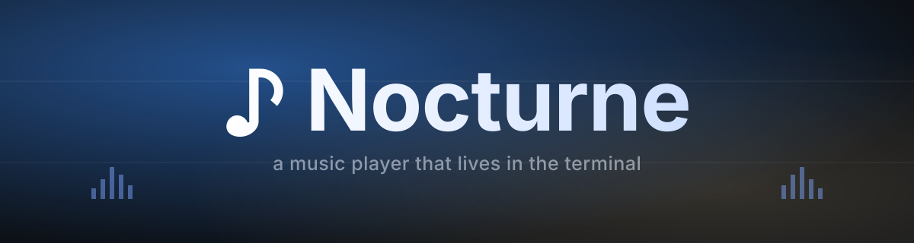
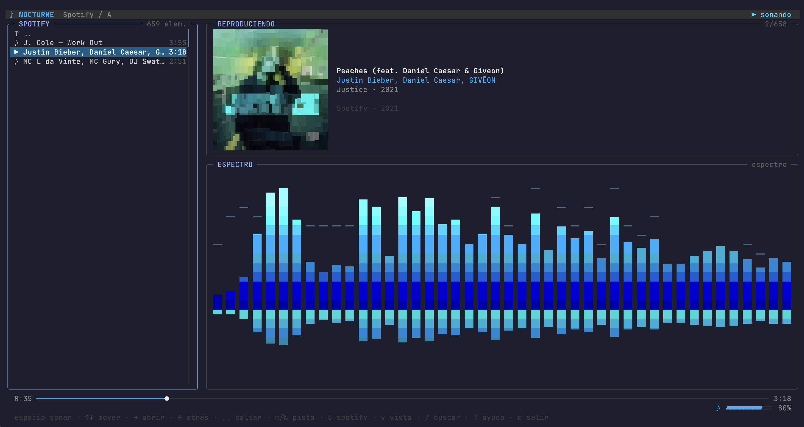
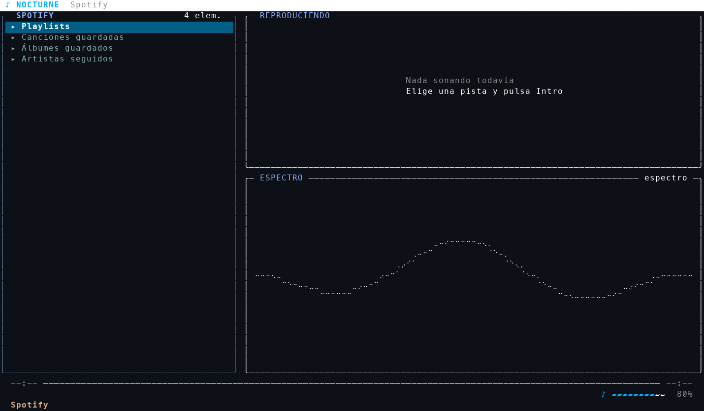
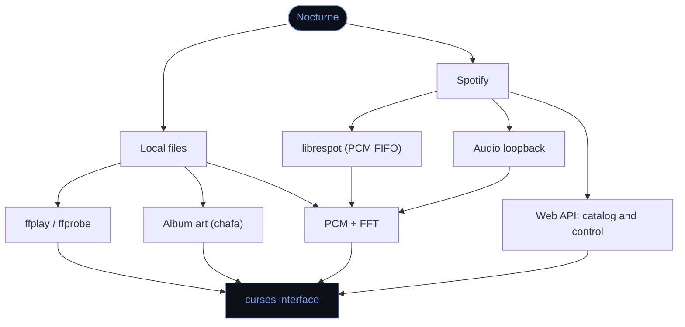

<p align="center">
  
</p>

<p align="center">
  
  
  
  
  
</p>

A music player for the terminal: a folder browser, a real-time spectrum, full-color album art and your Spotify, without ever leaving the console.

No dependencies to `pip install`: the spectrum's FFT is written in plain Python.

<p align="center">
  
</p>

## Index

- [Why](#why)
- [Installation](#installation)
- [Usage](#usage)
- [Keys](#keys)
- [The three visualizers](#the-three-visualizers)
- [Spotify](#spotify)
- [How it fits together](#how-it-fits-together)
- [Under the hood](#under-the-hood)
- [Troubleshooting](#troubleshooting)
- [Roadmap](#roadmap)
- [License](#license)

## Why

Nocturne started from a simple idea: **keep everything I use without leaving the terminal**. The first piece is a music player, and the plan is for it to grow into more tools built to live in the console.

It's built for a specific kind of person: someone who likes the look of a terminal, works keyboard-first, and would rather not get pulled into a GUI just to play a song.

- Runs entirely from the keyboard.
- Nothing to install with `pip` — the spectrum's FFT is plain Python.
- Plays your local files and your Spotify, from the same interface.

<details>
<summary><b>Text rendition of the interface</b></summary>
<br>

```text
 ♪ NOCTURNE  ~/Music                                                                 ▶ playing
╭─ LIBRARY ──────────── 2 items ╮ ╭─ NOW PLAYING ────────────────────────────────────── 1/1 ─╮
│ ↑ ..                          │ │ ▏▄▄▂▗▄▄▄▃▄▄▄▄▄▄▄▄▂                                        │
│ ▶ HAVEN. - I Run.mp3     2:09 │ │ ▕▏▕▝▋▏▏ ▔ ▋▗▊▏▕▏▕▏  I Run                                 │
│                               │ │ ▕▏▕▖▋▕▔▏▗ ▋▏▊▏▁▔▕▄  Haven., Kaitlin Aragon                │
│                               │ │ ▎▏▕▍▋▎▗▌▍▁▝▖▊▏▊▏▕▕  I Run · 2025                          │
│                               │ │ ▕▅▅▁▝▅▅▅▘▅▄▅▅▅▅▅▅▌  Electro                               │
│                               │ │ ▕▏▁▝▘▔▁▝▔▏▝▁▖▏▕▋▆▎                                        │
│                               │ │ ▗▝▆▆▎▗▖▏▏▏▕▏▏▊▝▃▘▊  MP3 · 320 kbps · 44.1 kHz · stereo    │
│                               │ │ ▏▌▂▘▂▕▁▕▔▏▕▆▏▗▄▞▘▊                                        │
│                               │ │ ▖▕▁▝▄▝▝▁▂▅▃▅▖▃▄▏▃▏                                        │
│                               │ ╰───────────────────────────────────────────────────────────╯
│                               │ ╭─ SPECTRUM ──────────────────────────────────────spectrum ─╮
│                               │ │                                           ▔                │
│                               │ │                         ▔     ▔     ▁   ▃ ▂   ▔ ▆          │
│                               │ │                     ▔ ▔ ▆ ▔ ▔ █ ▇ ▁ █ ▔ █ █ ▔ █ █ ▅ ▔      │
│                               │ │                   ▔   ▂ █ █ ▁ █ █ █ █ █ █ █ █ █ █ █ █ ▔ ▔  │
│                               │ │                   ▃ ▃ █ █ █ █ █ █ █ █ █ █ █ █ █ █ █ █ ▇ █  │
│                               │ │           ▁ ▔ ▔ ▔ █ █ █ █ █ █ █ █ █ █ █ █ █ █ █ █ █ █ █ █  │
│                               │ │                 ▇ ▅ ▅ ▃ █ █ ▃ █ █ ▁ █ █ █ █ █ █ █ █ ▁ ▄ ▃  │
│                               │ │                         ▇     ▅ ▇   ▆   ▅ ▆ ▇ ▅ ▄ ▇        │
╰───────────────────────────────╯ ╰───────────────────────────────────────────────────────────╯
  0:03 ━━●──────────────────────────────────────────────────────────────────────────────── 2:09
                                                                             ♪ ▱▱▱▱▱▱▱▱▱▱  70%
  space play · ↑↓ move · → open · ← back · ,. seek · n/N track · v view · / search · ?…
```

The left block of the *NOW PLAYING* panel is the album art in full color; it shows black and white here because this is plain text.

</details>

## Installation

| Tool | What for | Required |
|---|---|:-:|
| `python3` (3.10+) | the program itself | ✅ |
| `ffplay`, `ffprobe`, `ffmpeg` | playback, tag reading, decoding | ✅ |
| `chafa` | drawing the album art | optional |
| `librespot` | playing Spotify inside Nocturne | optional |

```sh
brew install ffmpeg chafa
```

> [!NOTE]
> Nocturne is developed and tested on **macOS**. It's written in Python and uses tools that also exist on Linux, but it hasn't been tested there. One of the Spotify options (the audio loopback via BlackHole) is macOS-specific.

To clone it and have it available from anywhere:

```sh
git clone https://github.com/alexcalatyd/Nocturne.git
cd Nocturne
ln -s "$PWD/bin/nocturne" /opt/homebrew/bin/nocturne
```

## Usage

```sh
nocturne              # the current folder
nocturne ~/Music      # a specific folder
nocturne song.mp3     # starts playing that file
```

If you haven't linked it into your `PATH`, use `./bin/nocturne` from the project folder.

<details>
<summary><b>All the options</b></summary>
<br>

| Option | What it does |
|---|---|
| `-v`, `--volume 0-100` | starting volume (80 by default) |
| `--viz bars\|wave\|dual` | visualizer to start with |
| `--no-art` | don't draw album art |
| `--symbols ...` | chafa's symbol set (`vhalf+block+space` by default) |
| `--fps N` | redraws per second (30 by default) |
| `--sync SEG` | shifts the spectrum relative to the audio if it looks ahead |
| `--spotify` | start directly in the Spotify tree |
| `--spotify-login` | authorize Nocturne on your account (see [Spotify](#spotify)) |
| `--spotify-device-login` | authorize the librespot speaker (once) |
| `--no-spotify` | ignore Spotify even if it's configured |
| `--spotify-audio ...` | `auto`, `pipe`, `loopback` or `none` |
| `--spotify-lag SEG` | spectrum delay relative to what's already playing |

</details>

## Keys

<table>
<tr>
<td valign="top" width="50%">

**Playback**

| Key | Action |
|---|---|
| `space`, `p` | play or pause |
| `enter`, `→` | open folder or play |
| `n` / `N` | next / previous track |
| `.` / `,` | seek ±5 s |
| `>` / `<` | seek ±30 s |
| `0`–`9` | jump to 0%–90% |
| `s` | shuffle |
| `r` | repeat: off → folder → one |
| `a` | chain tracks when one ends |

</td>
<td valign="top" width="50%">

**Navigation**

| Key | Action |
|---|---|
| `↑` `↓` or `k` `j` | move selection |
| `→` or `l` | enter folder |
| `←` or `h` | go back |
| `g` / `G` | top / bottom |
| `PgUp` / `PgDn` | page up / down |
| `/` | search (`Esc` clears it) |
| `u` | reload the folder |
| `o` | show non-audio files |

</td>
</tr>
<tr>
<td valign="top">

**Spotify**

| Key | Action |
|---|---|
| `S` | switch between your files and Spotify |
| `/` | in Spotify, `Enter` searches the catalog |
| `d` | show listening devices |

</td>
<td valign="top">

**Sound and view**

| Key | Action |
|---|---|
| `+` / `-` | volume ±5 |
| `m` | mute |
| `v` / `V` | switch visualizer |
| `c` | show or hide the album art |
| `?` | help |
| `q` | quit |

</td>
</tr>
</table>

## The three visualizers

- **spectrum** — bars over logarithmic bands (40 Hz – 10 kHz), with a reflection and peak markers that fall slowly.
- **wave** — an oscilloscope drawn with Braille dots, at quadruple vertical resolution.
- **dual** — bars on top, wave below.

Switch between them with `v` / `V`, or start on a specific one: `nocturne --viz wave`.

## Spotify

Nocturne can browse your playlists and play them without leaving the terminal.

> [!IMPORTANT]
> Controlling playback requires **Spotify Premium** — the Connect API doesn't allow it on free accounts. Browsing and reading metadata works without Premium.

<p align="center">
  
</p>

### Connecting it (one time only)

1. Go to the [Spotify developer dashboard](https://developer.spotify.com/dashboard) and create an app (the name doesn't matter).
2. Add this exact Redirect URI: `http://127.0.0.1:8898/callback`. It has to be the IP — since 2025 Spotify no longer accepts `localhost`.
3. Copy the *client id* and run:

```sh
nocturne --spotify-login --spotify-client-id YOUR_CLIENT_ID
```

The browser opens, you authorize, and that's it. To clear the session: `nocturne --spotify-logout`.

> [!TIP]
> **Your credentials never live inside the project.** The refresh token is stored at `~/.config/nocturne/spotify.json` with `600` permissions and renews itself. No *client secret* is needed, because the flow is Authorization Code + PKCE.

Inside Nocturne, `S` switches between your folders and the Spotify tree: playlists, saved tracks, albums, followed artists and search. Each tree remembers where you left it. The queue, shuffle and repeat are still handled by Nocturne — tracks are sent one at a time so Spotify doesn't chain its own queue on top.

### Where the sound comes from

Nocturne **controls** playback, but the audio itself comes from a Spotify Connect device. There are two ways to set that up, and the spectrum depends on which one you pick:

| | Option | Spectrum | Notes |
|:-:|---|:-:|---|
| **a** | `librespot` | ✅ exact | Everything stays in the terminal. Gray-area territory re: Spotify's terms (see below) |
| **b** | Official app + audio loopback | ✅ | No gray area. Needs BlackHole or similar |
| | Neither | ❌ | You still browse and control playback, but the spectrum stays flat |

<details>
<summary><b>a) librespot: everything in the terminal, with an exact spectrum</b></summary>
<br>

`librespot` is a reverse-engineered Connect client that can write raw PCM to a FIFO. Nocturne reads it, sends it to the audio output through ffmpeg, and keeps a copy for the FFT along the way, so the drawing matches exactly what's playing.

```sh
brew install librespot
nocturne --spotify-device-login    # once
```

From there on there's nothing else to do: Nocturne starts librespot on its own the first time you play something and kills it on exit. The speaker shows up as **Nocturne** and takes priority over any other device you have.

That login is separate from Nocturne's own because librespot uses its own Spotify client id; the credentials live under `~/.cache/nocturne/librespot`.

> [!WARNING]
> librespot violates Spotify's terms of service. In practice it's used by thousands of installs (moOde, Volumio, spotifyd) and bans over it are very rare, but it's your account and your call.

</details>

<details>
<summary><b>b) The official app + an audio loopback: no gray area</b></summary>
<br>

Leave the Spotify app playing and capture the system output with a loopback device ([BlackHole](https://existential.audio/blackhole) plus a multi-output device, for example). Nocturne detects it on its own and uses it for the spectrum.

</details>

The Spotify API doesn't expose audio, and the analysis endpoints (`audio-features`, `audio-analysis`) have been closed to new apps since November 2024. If the spectrum looks out of sync with the sound, adjust it with `--spotify-lag` (seconds; 0.22 by default).

## How it fits together



## Under the hood

<details>
<summary><b>How it works</b></summary>
<br>

- **Playback**: `ffplay -nodisp`. Its master clock (the actually-audible position) is read from stderr every ~30 ms, so the progress bar and the spectrum never drift apart. Pausing is done with `SIGSTOP`/`SIGCONT`, discounting the paused time, and seeks relaunch the process with `-ss`.
- **Spectrum**: when a track opens, it's fully decoded to mono 22,050 Hz PCM into a temp file (≈0.2 s) that gets memory-mapped. Every frame reads a 2,048-sample window at the exact playback position and runs a radix-2 FFT in plain Python (~1.3 ms). An automatic gain control keeps peaks just under the ceiling without pumping.
- **Album art**: the embedded image is extracted with ffmpeg (or a `cover.jpg` next to the file is used instead) and piped through chafa. The resulting ANSI block is written straight into the terminal, over a rectangle curses leaves untouched.
- **Tags**: `ffprobe` runs in background threads, prioritizing whatever's visible on screen, so a folder with hundreds of tracks doesn't stall.
- **Spotify**: the catalog is browsed through the Web API and played via Connect, with a local clock corrected against `/me/player` every two seconds (more often would hit the rate limit). HTTPS connections are reused — opening TCP+TLS against the API costs about 45 ms, and that cost used to be paid on every command. Moving to the next track in the same context sends `/me/player/next` instead of a fresh play, because librespot already has it downloaded and it starts instantly; jumps that break the order (shuffle, repeat-one) do need a fresh play. Downloaded audio is cached at `~/.cache/nocturne/librespot/audio` (up to 1 GB). The spectrum comes from a six-second circular buffer feeding ffmpeg, read a few milliseconds behind the head to compensate for the audio output's own latency.

Every child process launches in its own session: with no controlling terminal, none of them can query the terminal or steal keystrokes from the user.

</details>

<details>
<summary><b>Project layout</b></summary>
<br>

```text
nocturne/
  app.py          main loop, keyboard and playback queue
  player.py       ffplay control (position, pause, seek, volume)
  analysis.py     PCM cache, FFT and spectrum bands
  visualizer.py   bars, Braille oscilloscope and smoothing
  artwork.py      album art extraction and chafa rendering
  library.py      folder browsing and metadata
  spotify/
    auth.py       OAuth PKCE and refresh-token custody
    client.py     Web API client over urllib
    source.py     the Spotify catalog as a folder tree
    player.py     playback control via Spotify Connect
    capture.py    PCM for the spectrum (librespot FIFO or audio loopback)
    device.py     starts and stops librespot as its own speaker
    session.py    wires the pieces together, decides where audio comes from
  ui.py           curses layout and drawing
  theme.py        night-blue palette
  util.py         text, time formatting, natural sort
bin/nocturne      launcher
```

</details>

## Troubleshooting

<details>
<summary><b><code>cbreak() returned ERR</code>, or stray codes like <code>[?1049h</code> show up</b></summary>
<br>

The program didn't get an interactive terminal — this usually happens when launching it from another tool's prompt, or through a pipe. Nocturne reopens `/dev/tty` on its own when it can; if none exists, it says so and exits. Open it in a normal terminal window.

</details>

<details>
<summary><b>No album art shows up</b></summary>
<br>

Check that you have `chafa` (`brew install chafa`) and that the track has embedded art or a `cover.jpg` next to it. `c` toggles it.

</details>

<details>
<summary><b>The spectrum runs ahead of the sound</b></summary>
<br>

Adjust it with `--sync 0.05` (seconds, negative values allowed). On Spotify, use `--spotify-lag` instead.

</details>

<details>
<summary><b>librespot gets stuck on "Connecting to AP …:4070"</b></summary>
<br>

The network is blocking that port. This happens on school, office and hotel WiFi that only lets 80 and 443 through. Login and browsing keep working because they go over HTTPS; what can't happen is playback. Try a different connection.

</details>

<details>
<summary><b>"No Spotify device is listening"</b></summary>
<br>

Nocturne sends commands, it doesn't open the audio output on its own. With librespot installed and authorized, it handles this by itself; otherwise it needs the official app open and playing. `d` shows which devices it finds.

</details>

<details>
<summary><b>Spotify replies "this action requires Premium"</b></summary>
<br>

That's expected — the Connect API doesn't control free accounts. Browsing and reading metadata still works.

</details>

<details>
<summary><b>For debugging</b></summary>
<br>

`NOCTURNE_DEBUG_LOG=path` traces navigation and playback commands; `NOCTURNE_LIBRESPOT_LOG=path` saves librespot's output, which is the only thing that explains why a given track isn't playing.

</details>

## Roadmap

- [x] Folder browser with tags and search
- [x] Local playback with ffplay
- [x] Real-time spectrum (FFT in plain Python)
- [x] Three visualizers
- [x] Album art with chafa
- [x] Spotify: browsing, search and playback via Connect
- [x] Spotify spectrum via librespot or audio loopback
- [ ] A chat to talk to friends from the terminal
- [ ] A browser in the terminal
- [ ] More tools for living in the console

> Nocturne started as a player, and the idea is for it to become a place to do more things without leaving the terminal, so the roadmap is likely to change.

## License

MIT — see [LICENSE](LICENSE).

<p align="center"><sub>♪ Fewer windows. More terminal.</sub></p>
